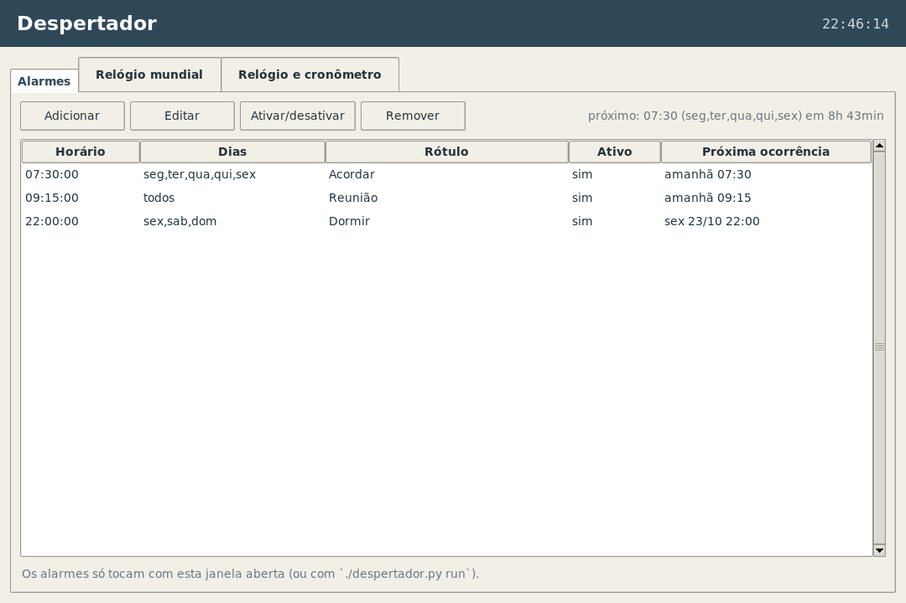
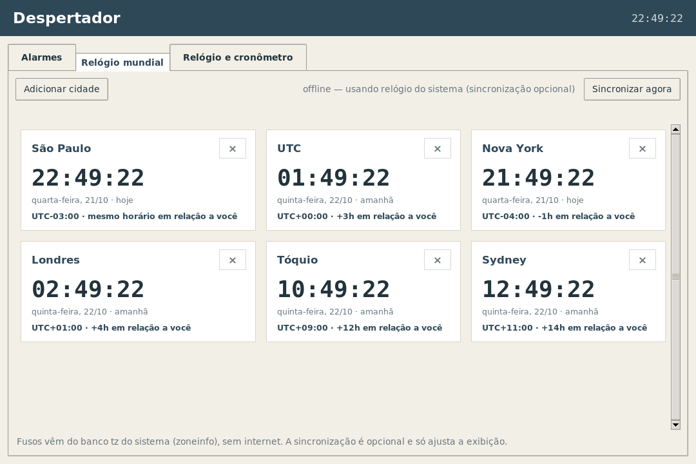
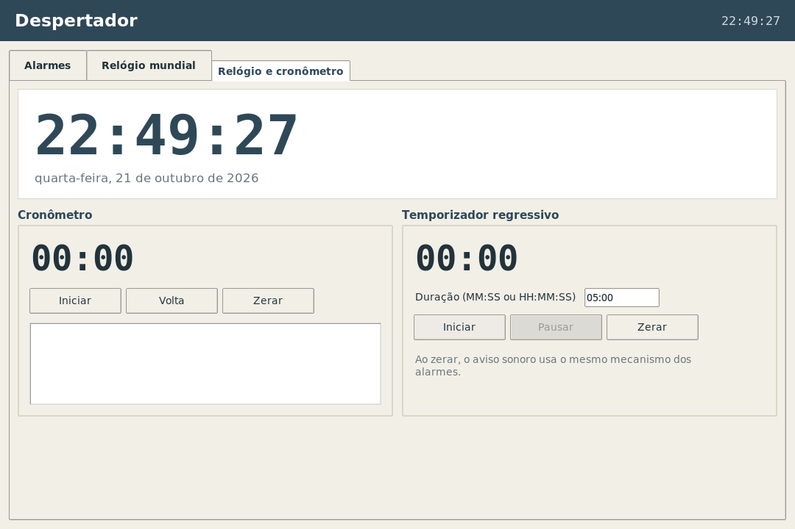

# Despertador

[](https://github.com/glearflame/despertador/actions/workflows/ci.yml)
[](https://www.python.org/)
[](https://github.com/glearflame/despertador/actions/workflows/ci.yml)
[](LICENSE)

Despertador para Linux com **interface gráfica em Tkinter** e **linha de comando**,
em **Python puro** (só biblioteca padrão, nenhuma dependência no runtime).
Versão atual: **1.3.0** — veja o [CHANGELOG.md](CHANGELOG.md).

> **Aviso importante:** os alarmes só tocam com o aplicativo aberto
> (`./despertador_gui.py`) ou com o laço da CLI rodando (`./despertador.py run`).
> Não há daemon nem integração com systemd; ao abrir depois de um horário
> perdido, ocorrências das últimas 2 horas ainda disparam.

## Requisitos

- Python 3.10+ com Tkinter (no Debian/Kali: pacote `python3-tk`).
- Opcional: um player de áudio (`paplay`, `aplay`, `ffplay` ou
  `canberra-gtk-play`). Sem player, o app usa a campainha do terminal/Tk.
- Opcional: `notify-send` para notificações de desktop.
- O relógio mundial usa o banco tz do sistema via `zoneinfo` — **funciona
  offline**, sem rede.

O runtime é 100% stdlib. `pytest` e `ruff` são usados apenas no desenvolvimento.

## Aplicativo desktop

```bash
cd despertador
chmod +x despertador_gui.py   # já vem com +x
./despertador_gui.py
```

Opções úteis:

```bash
./despertador_gui.py --tab mundial   # abre direto no relógio mundial
./despertador_gui.py --tab relogio   # abre direto no relógio/cronômetro
./despertador_gui.py --debug         # registra eventos no stderr
./despertador_gui.py --version
```

### Aba Alarmes



Lista horário, dias, rótulo, estado (ativo/inativo) e próxima ocorrência.
Permite adicionar, editar (duplo clique também abre o editor), remover e
ativar/desativar. O editor aceita `HH:MM` ou `HH:MM:SS`, dias específicos,
soneca, som próprio e “tocar uma vez”.

Quando um alarme vence, abre uma janela modal em destaque, com o rótulo e os
botões **Soneca 5 min** e **Parar**. O som toca em loop enquanto a modal estiver
aberta, pela mesma cadeia da CLI:

`paplay` → `aplay` → `ffplay` → `canberra-gtk-play` → campainha.

Se `notify-send` existir, uma notificação também é disparada.

### Aba Relógio mundial



Cards com cidade, hora local, dia da semana/data, offset UTC e diferença em
relação ao seu fuso (ex.: `+3h`, `-5h30`, `mesmo horário`). Cidades padrão:
São Paulo, UTC, Nova York, Londres, Tóquio e Sydney.

- **Adicionar cidade**: busca textual na lista de fusos IANA
  (`zoneinfo.available_timezones()`), por exemplo `tokyo` ou `america/`.
- **Remover cidade**: botão `×` no card.
- Atualização a cada segundo, **offline por padrão**, usando o banco tz do
  sistema. A lista escolhida é salva em
  `$XDG_CONFIG_HOME/despertador/worldclock.json`.

### Aba Relógio e cronômetro



- Relógio grande com data completa em português.
- Cronômetro com iniciar/pausar, zerar, voltas e histórico.
- Temporizador regressivo (`MM:SS` ou `HH:MM:SS`) com iniciar/pausar/retomar,
  zerar e aviso sonoro ao terminar, reaproveitando o mecanismo de som dos
  alarmes.

## AppImage (arquivo único para Linux)

Para usar o app numa máquina **sem Python nem Tkinter instalados**, gere um
**AppImage**: um arquivo único, executável e portátil, que já embute o
interpretador CPython e o Tk.

### Gerar

```bash
cd despertador
chmod +x build_appimage.sh
./build_appimage.sh
```

O script pode ser chamado de qualquer diretório (usa o próprio caminho como
base), não usa `sudo` e faz o ciclo completo:

1. limpa `build/`, `dist/` e `Despertador.AppDir/`;
2. garante o PyInstaller (usa o instalado; senão `pip install --user`; senão uma
   venv de build em `~/.cache/despertador-appimage/`);
3. gera o ícone 256×256 com ImageMagick (`scripts/make_icon.sh`, também
   disponível como `make icon`; o arquivo versionado é `docs/despertador.png`);
4. empacota `despertador_gui.py` + pacote `despertador/` com
   `pyinstaller --onefile --windowed --name despertador-app`;
5. monta o AppDir (`AppRun`, `despertador.desktop`, `despertador.png`,
   `usr/bin/despertador-app`);
6. baixa o `appimagetool` oficial (só na primeira vez, com cache em
   `~/.cache/despertador-appimage/`) e escreve
   `dist/Despertador-x86_64.AppImage`.

Atalhos: `make appimage` (build) e `make verify-appimage` (checagem headless).

### Rodar

```bash
chmod +x dist/Despertador-x86_64.AppImage
./dist/Despertador-x86_64.AppImage
```

Aceita os mesmos argumentos da GUI, por exemplo
`./dist/Despertador-x86_64.AppImage --tab mundial` ou `--version`.

### Requisitos na máquina de destino

- Linux **x86_64** com X11/Wayland e as bibliotecas gráficas usuais do Tk
  (`libX11`, `libXft`, `libfontconfig`, Tcl/Tk do sistema) — presentes em
  qualquer desktop comum.
- **Python não é necessário**: o interpretador vai dentro do AppImage.
- Algumas distros exigem o `libfuse2` para *montar* o AppImage (Ubuntu 22.04+ é
  o caso clássico). Sem ele, use o fallback que extrai para um diretório
  temporário em vez de montar:

```bash
APPIMAGE_EXTRACT_AND_RUN=1 ./dist/Despertador-x86_64.AppImage
```

- O relógio mundial continua usando o banco de fusos do sistema
  (`/usr/share/zoneinfo`); sem `tzdata`, restam UTC e os fusos fixos.

### Tamanho

Aproximadamente **15 MB** por build (CPython + Tcl/Tk + runtime squashfs
embutidos). No build validado da versão 1.3.0: **14.924.280 bytes ≈ 14,2 MiB**
(`ls -lh` mostra `15M`). O valor exato sai no fim do build com
`ls -lh dist/`.

### Verificação

```bash
make verify-appimage
```

Abre a GUI headless num Xvfb próprio, salva um screenshot em
`/tmp/appimage-run.png` e confere que a imagem não é preta/uniforme
(`mean`/`stddev`/nº de cores via ImageMagick), repete com `env -i` (sem
`PYTHONPATH`, sem venv, sem ambiente do projeto) e executa uma segunda vez para
descartar problemas de cache.

## Sincronização com API de horário (opcional)

O botão **Sincronizar agora**, na aba de relógio mundial, consulta uma API
pública para medir o desvio do relógio local:

1. `https://worldtimeapi.org/api/timezone/{zona}` (primária)
2. `https://timeapi.io/api/Time/current/zone?timeZone={zona}` (alternativa)

Regras de funcionamento:

- Timeout curto de **5 s**, em **thread separada** — a interface nunca trava.
- Sem internet: a UI mostra **“offline — usando relógio do sistema”** e segue
  funcionando; nenhuma exceção aparece ao usuário.
- O desvio medido é **apenas de exibição**: `despertador_gui.py` nunca altera o
  relógio do sistema (nada de `date`, NTP ou privilégios).
- O parsing das respostas é feito por funções puras (`parse_worldtimeapi` e
  `parse_timeapi`), testáveis sem rede.

Exemplo de resultado: “online via worldtimeapi · relógio local adiantado em 2,3s”.

## PC não dorme enquanto houver alarme ativo

Enquanto existir pelo menos um alarme ativo (com ocorrência futura ou soneca
pendente), o aplicativo mantém um **inhibitor do logind**:

```bash
systemd-inhibit --what=idle:sleep:shutdown --who=Despertador \
    --why="Despertador: alarme às 05:00" --mode=block sleep infinity
```

Isso impede suspender, hibernar e desligar o PC. Quando não há alarme ativo, o
processo é encerrado e o PC volta a poder dormir. Nenhuma configuração do
sistema (logind.conf, XFCE etc.) é alterada — a garantia vem só do inhibitor.

- **GUI:** o estado aparece no cabeçalho (“🔒 PC não vai dormir até amanhã
  05:00” ou “PC pode dormir (nenhum alarme ativo)”). O inhibitor é recalculado
  ao adicionar/editar/ativar/desativar/remover/disparar alarmes e liberado ao
  fechar a janela. Soneca mantém o PC acordado; “Parar” libera se não houver
  outro alarme ativo.
- **CLI (qualquer modo):** `./despertador.py run` e `./despertador.py inhibit`
  fazem o mesmo: mantêm o inhibitor **enquanto houver alarme pendente**, tocam
  o alarme na hora certa, aceitam soneca/parar e só liberam o inhibitor quando
  não resta nenhum alarme. `inhibit` existe por compatibilidade com a versão
  anterior. Para deixar em segundo plano:

  ```bash
  nohup ./despertador.py inhibit > ~/.despertador-inhibit.log 2>&1 &
  ```

  `./despertador.py inhibit --status` mostra se há inibidor ativo e por quê
  (esse modo apenas informa, sem bloquear).

Se o `systemd-inhibit` não existir, o aplicativo avisa e continua funcionando
(sem a garantia de não suspender). Para conferir o inibidor em execução:

```bash
systemd-inhibit --list | grep Despertador
```

## Linha de comando (compatível com a versão anterior)

```bash
./despertador.py --version
./despertador.py add 07:30 --label "acordar"
./despertador.py add 06:45 --days seg,ter,qua,qui,sex --once \
    --label "trabalho" --sound ~/Music/alarme.ogg
./despertador.py list
./despertador.py next
./despertador.py disable 2
./despertador.py enable 2
./despertador.py rm 2
./despertador.py inhibit          # mantém o PC acordado e toca os alarmes
./despertador.py inhibit --status # mostra o inibidor ativo e o próximo alarme
```

Para deixar tocando em primeiro plano:

```bash
./despertador.py run
```

Em segundo plano, sobrevivendo ao fechamento do terminal:

```bash
nohup ./despertador.py run > ~/.despertador.log 2>&1 &
tail -f ~/.despertador.log
```

### Opções de `add`

| Opção | Descrição |
|---|---|
| `--label TEXTO` | rótulo livre |
| `--days seg,ter` (ou `"seg ter"`) | dias da semana; ausente = todos |
| `--once` | toca uma vez e se desativa |
| `--sound ARQUIVO` | som customizado |
| `--snooze MIN` | minutos de soneca (padrão 5) |

Horário aceita `HH:MM` e `HH:MM:SS` (o segundo formato é útil para testes).

### Ao tocar na CLI

- `s` = soneca (5 min por padrão; veja `--snooze` no `add`)
- `q` = parar
- `Enter` ou nada = continua tocando

Se a entrada não for um terminal (ex.: script/CI), o programa toca por
`--ring-seconds` segundos (padrão 60) e encerra.

### Parâmetros de `run`

```bash
./despertador.py run --grace-hours 2 --ring-seconds 60 --snooze 5
```

- `--grace-hours X`: janela para considerar um alarme perdido (padrão 2h).
- `--ring-seconds N`: duração do toque em modo não interativo (padrão 60).
- `--snooze MIN`: soneca padrão para alarmes sem configuração própria.

`run` e `inhibit` aceitam os mesmos parâmetros e fazem o mesmo trabalho;
`inhibit --status` apenas informa o estado.

## Persistência

Alarmes em `$XDG_CONFIG_HOME/despertador/alarms.json`
(padrão `~/.config/despertador/alarms.json`), diretório com permissão `700` e
gravação atômica (`os.replace`). Se o JSON estiver corrompido, o programa avisa,
copia o arquivo antigo para `alarms.json.bak` e começa com a lista vazia.

Cidades do relógio mundial em `$XDG_CONFIG_HOME/despertador/worldclock.json`.

## Estrutura do projeto

```text
despertador.py            # CLI (mesmo comportamento de antes)
despertador_gui.py        # aplicativo Tkinter (executável)
despertador/
    __init__.py           # reexporta o núcleo
    core.py               # parsing, ocorrências, persistência, som
    worldclock.py         # fusos, offsets, parsing das APIs, sincronização
    timers.py             # cronômetro e temporizador puros
    inhibit.py            # inhibitor do logind (não suspender com alarme ativo)
tests/
    test_despertador.py   # testes originais da CLI/núcleo
    test_core_gui.py      # operações usadas pela GUI e loop de som
    test_worldclock.py    # parsing, offsets e sincronização sem rede
    test_timers.py        # formatação e lógica dos temporizadores
    test_inhibit.py       # decisão de inibição e processo fake (sem systemd)
    test_cli_laco.py      # laço de run/inhibit com relógio, som e inhibitor fake
```

## Desenvolvimento

```bash
make check   # ruff + pytest (150 testes)
make lint
make test
make gui     # atalho para ./despertador_gui.py
```

Os testes não abrem display nem acessam a rede: a chamada HTTP é injetável e as
funções de parsing/offset são puras.

## Limitações reais

- Alarme e temporizador só tocam com o app (ou `run`) aberto.
- A sincronização depende de APIs públicas; se ambas estiverem fora do ar, o
  app permanece offline e mostra o motivo.
- Fusos e horários de verão vêm do banco tz do sistema; mantenha o pacote
  `tzdata` atualizado para regras recentes.
- Com vários alarmes vencidos ao mesmo tempo, a GUI mostra um por vez.
- O som em loop depende do player instalado; sem player, usa a campainha.

## Licença

Distribuído sob a licença **MIT** — copyright 2026 **Glear flame**.
Veja [LICENSE](LICENSE).

## Histórico de versões

Resumo de 1.0.0 a 1.3.0 em [CHANGELOG.md](CHANGELOG.md). A versão 1.3.0
corrige o `inhibit` que não tocava o alarme.
